<div align="center">


# Loupe

**A Metal image viewer for macOS that shows a 300-megapixel photo, fully sharp, in under a second from launch.**

Built for looking at beautiful things up close: space telescope mosaics, scans of old masters, huge AI renders,<br>
whole folders of photos on a NAS — with the keyboard, the trackpad or an MX Master.


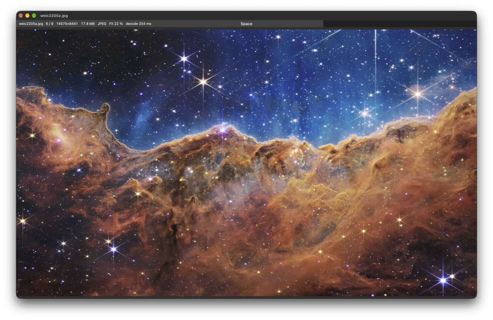

<sub>The Webb telescope's Cosmic Cliffs, 14 575 × 8 441 (123 MP), sharp on screen in under half a second from launch.</sub>

</div>

---

## Why Loupe

- **Huge images are not a special case.** A tiled Metal pyramid keeps 100–300 MP photos as fluid as a phone snapshot: zoom, pan, flick through a folder — no spinner, no blurry wait.
- **Every format gets its fastest decoder.** libjpeg-turbo for JPEG, a patched libjxl for JPEG XL (with an instant 1:8 preview), ImageIO for HEIC, AVIF, WebP, PNG, TIFF, GIF and BMP — chosen by the file's magic bytes, not its extension.
- **It predicts where you're going.** Neighbouring photos are decoded and uploaded to the GPU before you ask, so the next photo is already there.
- **A real home for your photos.** A Photos-style Home with Recent, Sessions, a folder browser with live covers, a sidebar tree, two thumbnail modes — and a native window onto your [Stash](https://github.com/stashapp/stash) library.
- **Every pixel on a big screen.** 100 % means one image pixel per physical pixel, not per Retina point, so a 6K display shows a 300 MP photo at its true resolution; MetalFX and Lanczos keep it clean when it is scaled.
- **Made for hands, not menus.** mpv-style `input.conf` bindings, trackpad gestures, right-button drag zoom with inertia, and first-class Logitech MX Master 4 support, haptics included.

## Made for big collections

Loupe is built for libraries of tens of thousands of photos on a NAS, not for a dozen snapshots on the desktop.

- **It remembers where you were.** The last photo, zoom and spot in each folder, for up to 1 000 folders, across launches. Come back a month later and land on the same picture.
- **Folders stay live.** New, removed and renamed files show up within about 300 ms, on SMB shares too, so a folder that is still being filled (a download, a sync, a render queue) updates on its own.
- **Zip archives are folders.** Browse and view zips on a share without unpacking or copying them.
- **Thumbnails are cached.** A SQLite catalog keeps thumbnails and folder covers, so a big folder opens with its grid already there the second time. The disk cache stays under 2 GB by default (`thumb-cache-size`), dropping the longest unseen first; **File → Clean Up Thumbnails** forgets files that are gone, **Clear Thumbnail Cache…** starts over.
- **Sessions.** **File → Save Session As…** keeps every window and tab under a name, to reopen from Home. *Last Session* is always there, and `session-restore=last` brings it back at launch.
- **Drop a folder on Home** to open it, or a single photo.
- **Tidy as you go.** Rename (`F2`) and move to the Trash right in the browser, sort by name, date or size per folder; Recent, Sessions and folder settings follow a rename.
- **Your Stash library** in a tab, with galleries opened straight from the share (see [Stash](#stash)).

## Numbers

Measured on a MacBook Pro with M4 Max (36 GB), macOS 27, on the public images credited [below](#image-credits). Every figure can be reproduced with the scripts in this repo.

**From launch to a sharp picture** (`scripts/startup-bench.py`, median of 5 cold launches, ms from exec):

| File | Window up | First picture | Full resolution on screen |
|---|---:|---:|---:|
| Webb *Cosmic Cliffs*, JPEG, 14 575 × 8 441 (123 MP) | 117 | 375 | **462** |
| Same image as JPEG XL (lossless JPEG transcode) | 156 | 481 | **481** |
| Hubble *Orion Nebula*, JPEG, 18 000 × 18 000 (324 MP) | 149 | 694 | **994** |
| Bruegel *The Harvesters*, JPEG, 3 840 px | 168 | 285 | **285** |

**JPEG XL decoding of the 123 MP image** (`LoupeBench`, wall time):

| Method | Full decode | Preview |
|---|---:|---:|
| Apple ImageIO | 363 ms | 392 ms |
| **Loupe's libjxl** (multithreaded) | **114 ms** — 3.2× faster | **20 ms** (1:8 DC image) |

Lossy JPEG XL: 194 ms vs ImageIO's 580 ms. The 20 ms preview comes from `JxlDecoderGetDCImage`, a small addition to libjxl that Loupe ships with: you see the whole photo almost at once, and the full resolution replaces it a moment later.

While you look, the stats bar (`i`) shows the file, its place in the folder, size, format, zoom and decode time. The info panel's Diagnostics (`⌘I`) adds the decoder, its timings, cache, memory and GPU frame times.

<p align="center">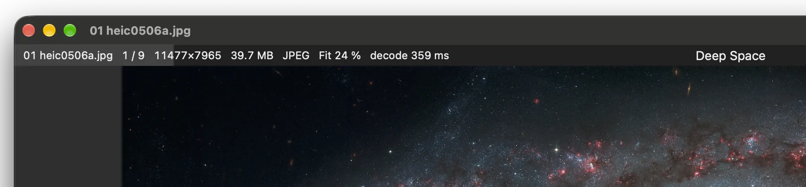</p>

## Features

<table>
<tr>
<td width="50%">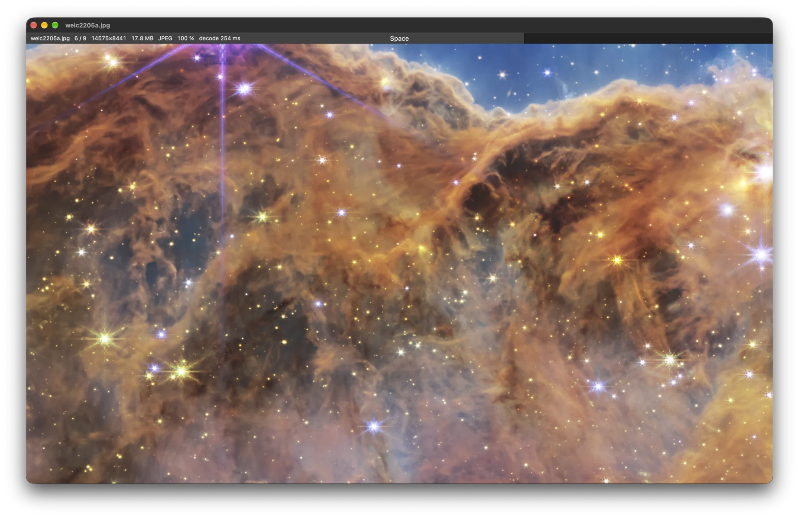</td>
<td width="50%">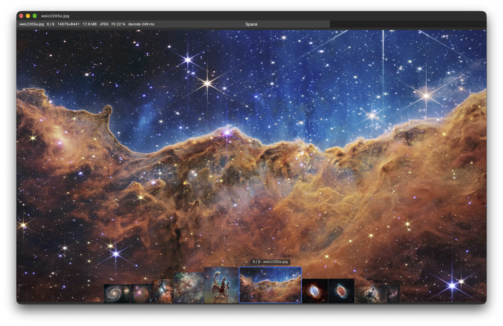</td>
</tr>
<tr>
<td><b>Every pixel, instantly.</b> <code>1</code> for 100 %, <code>2</code>/<code>4</code> for 200/400 %, pinch, double-tap Smart zoom, or hold the right button and drag. Zoom stops at fit-width, fit-height and 100 % click under your finger.</td>
<td><b>The strip.</b> A filmstrip like Photos': the current photo in the middle in its own shape, the rest narrow. Swipe with two fingers or drag it and every photo that reaches the middle opens; click to jump. How wide the thumbnails may grow is up to you (<code>strip-cell-max</code>, 9:16 … 3:2).</td>
</tr>
<tr>
<td>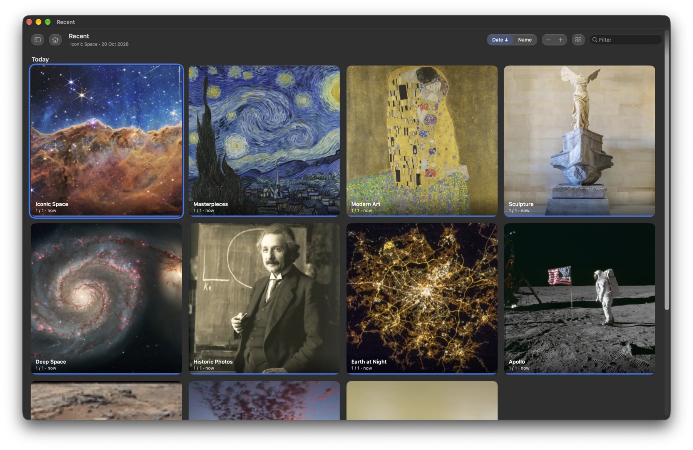</td>
<td>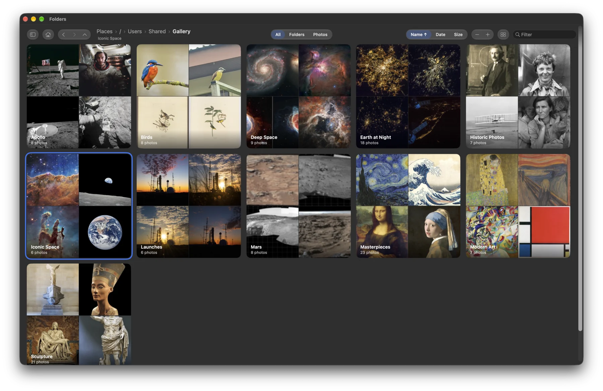</td>
</tr>
<tr>
<td><b>Home.</b> Recent folders with their covers and progress, Sessions you can save and reopen, and browser-like tabs and windows (with <code>session-restore=last</code> they all come back at launch).</td>
<td><b>Folders.</b> A fast browser with live four-photo covers, built on a SQLite thumbnail catalog. It browses zip archives on a share without copying them.</td>
</tr>
<tr>
<td>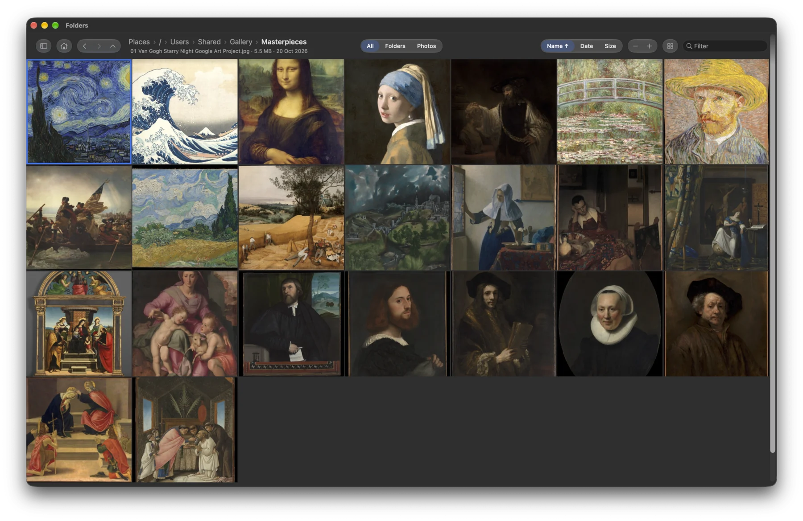</td>
<td>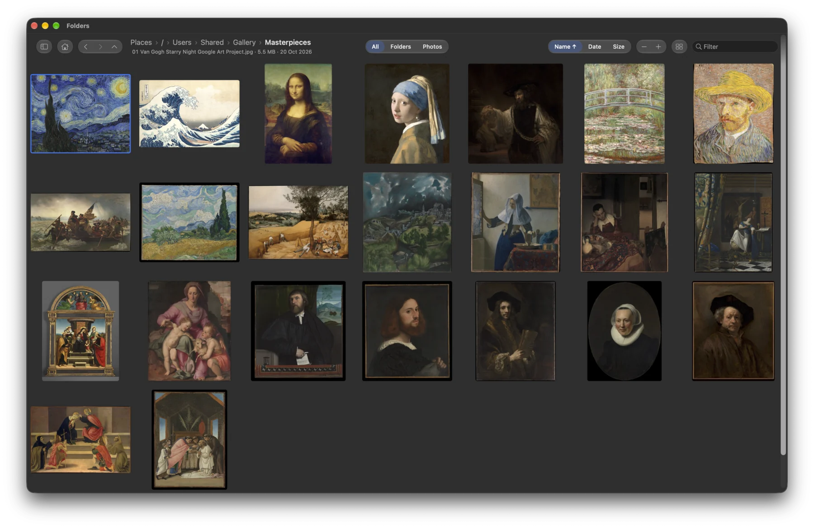</td>
</tr>
<tr>
<td colspan="2"><b>Two thumbnail modes.</b> <i>Square</i> for a calm, even grid like Photos; <i>Aspect</i> to see every picture whole, in its own proportions. One click in the toolbar, and Loupe remembers it.</td>
</tr>
<tr>
<td>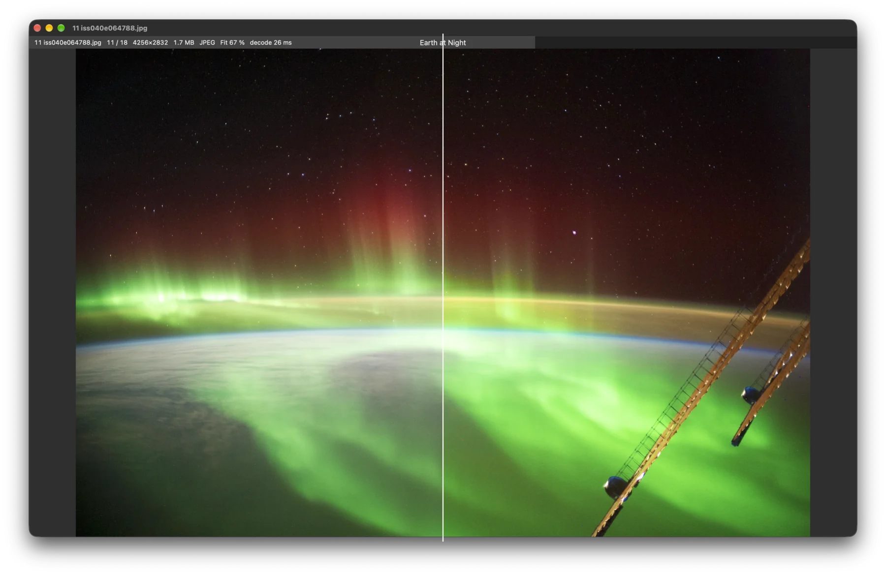</td>
<td>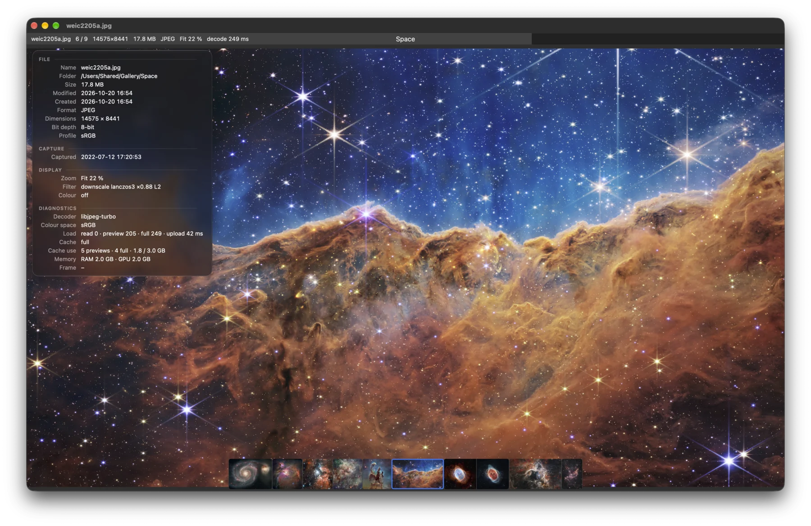</td>
</tr>
<tr>
<td><b>Auto colour and vibrance.</b> <code>c</code> and <code>v</code> for this folder (<code>⇧C</code> / <code>⇧V</code> make it the default) — left half original, right half corrected. Applied on the GPU as a colour cube, never written to your files.</td>
<td><b>Info panel.</b> <code>⌘I</code>: file, EXIF, colour profile, bit depth, the decoder and its timings, memory — and the A1111 generation parameters a PNG, JPEG or WebP carries (a ComfyUI workflow is noted with its size).</td>
</tr>
<tr>
<td>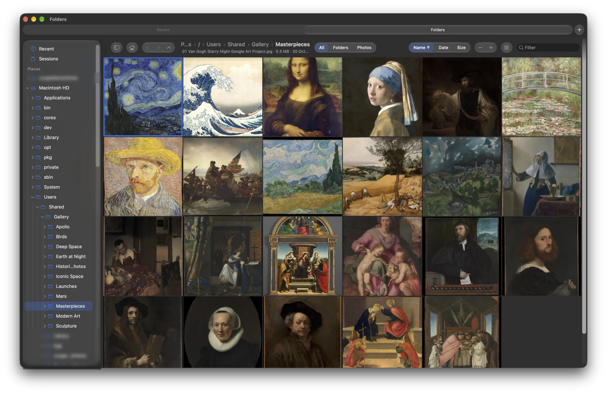</td>
<td>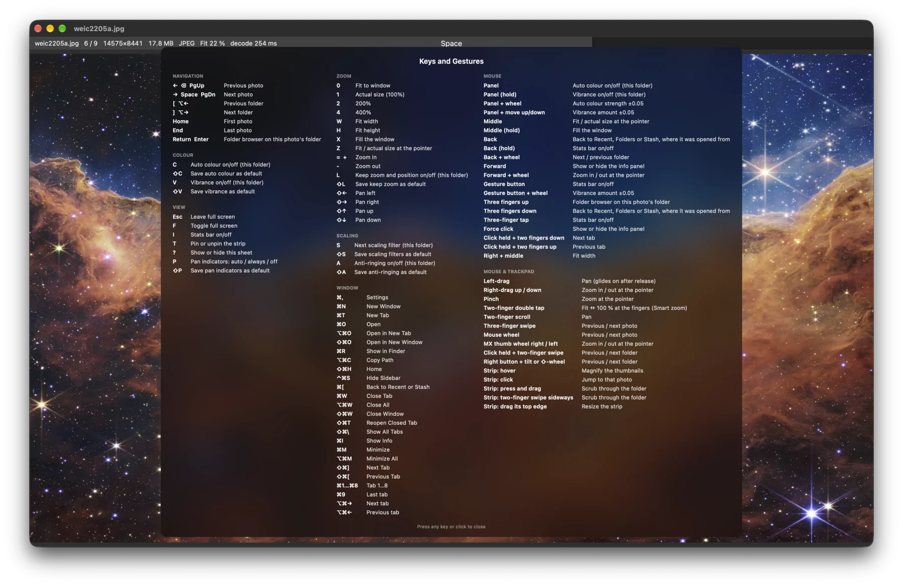</td>
</tr>
<tr>
<td><b>Sidebar.</b> Sources and places with a folder tree that follows you, for deep libraries.</td>
<td><b>Everything is a key.</b> <code>?</code> shows every binding of your current layout, gestures included.</td>
</tr>
</table>

### Formats

JPEG, HEIC/HEIF, AVIF, JPEG XL, WebP, PNG, GIF (first frame), TIFF and BMP, plus `.zip` archives, browsed as folders. RAW, PSD and other archive types are not supported yet, and neither is animation (it is on the [roadmap](ROADMAP.md)).

Loupe can be your default viewer for any of these: **Get Info → Open with → Change All…** in Finder. Each format then gets its own document icon.

### Keys

The most useful defaults. `?` shows every binding, gestures included; a capital letter means Shift.

| Key | Action | Key | Action |
|---|---|---|---|
| `←` `→` `Space` `⌫` | Previous / next photo | `0` | Fit to window |
| `⌥←` `⌥→` `[` `]` | Previous / next folder | `1` `2` `4` | 100 / 200 / 400 % |
| `Home` `End` | First / last photo | `w` `h` `x` | Fit width / fit height / fill |
| `Return` | Folder browser on this photo | `z` | Fit ↔ 100 % at the pointer |
| `⇧⌘H` | Home | `=` `-` | Zoom in / out |
| `⌘[` | Back to where it was opened from | `⇧` + arrows | Pan |
| `t` | Hide or show the strip (pin it in full screen) | `c` `v` | Auto colour / vibrance, this folder (`⇧C` `⇧V`: default) |
| `i` | Stats bar | `s` | Next scaling filter, this folder (`⇧S`: default) |
| `⌘I` | Info panel | `f` `Esc` | Full screen / leave it |
| `⌘T` `⌘N` `⌘W` | New tab / window, close tab | `⇧⌘T` | Reopen closed tab |
| `⌘1` … `⌘9` | Go to a tab | `⇧⌘L` | Stash library |
| `?` | Cheat sheet | `⌘,` | Settings |

Letters work by key, not by input language: with a Russian or Greek layout, the F key is still `f`. Digits and `=` `-` `[` `]` go by position, so AZERTY needs no Shift. Sessions are in the File menu. Every key and mouse binding can be changed in **Settings → Key Bindings** or in `input.conf` (see [Configure](#configure)).

### Image quality

Pick the resampling filter per folder (`s`, `⇧S` for the default): Lanczos-3 and Lanczos-2 with anti-ringing, Mitchell, Catmull-Rom, EWA Lanczos, bilinear, MetalFX spatial upscaling, and a crisp nearest-neighbour *pixel-art* mode for sprites and screenshots. Downscaling goes through a filtered pyramid, so a 300 MP photo at 20 % stays clean instead of shimmering. The render tests compare every filter pixel by pixel against Core Graphics and a CPU reference.

Around the picture: a checkerboard behind transparent pixels (or the background colour, black or white), any background colour you like, EXIF orientation on or off, and the strip either over the photo, as a fixed band under it, or not at all.

### Mouse, trackpad and MX Master

As far as we know, no other Mac app goes this deep into Logitech hardware, and it keeps growing.

- Three-finger swipes and taps, force click, two-finger scrolling through the strip, click-and-swipe chords.
- Right-button drag to zoom with inertia and rubber banding.
- **Logitech MX Master 4** over HID++ through the Bolt receiver, no Logi Options+: the haptic panel, gesture and shift buttons, button + wheel and button + move chords, and haptic feedback on zoom stops, limits, folder ends and more.
- Plays well with **Mac Mouse Fix**: Loupe still hears the MX Master's back and forward buttons while Mac Mouse Fix has them (`mx-side-buttons`).

<p align="center">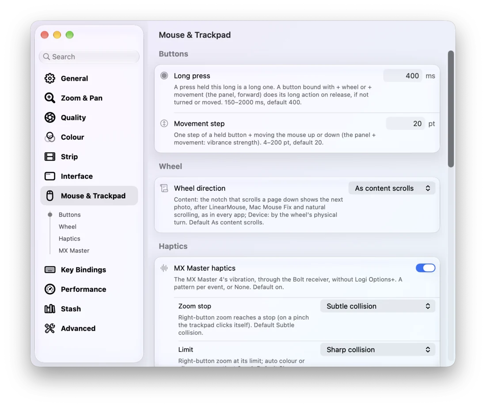 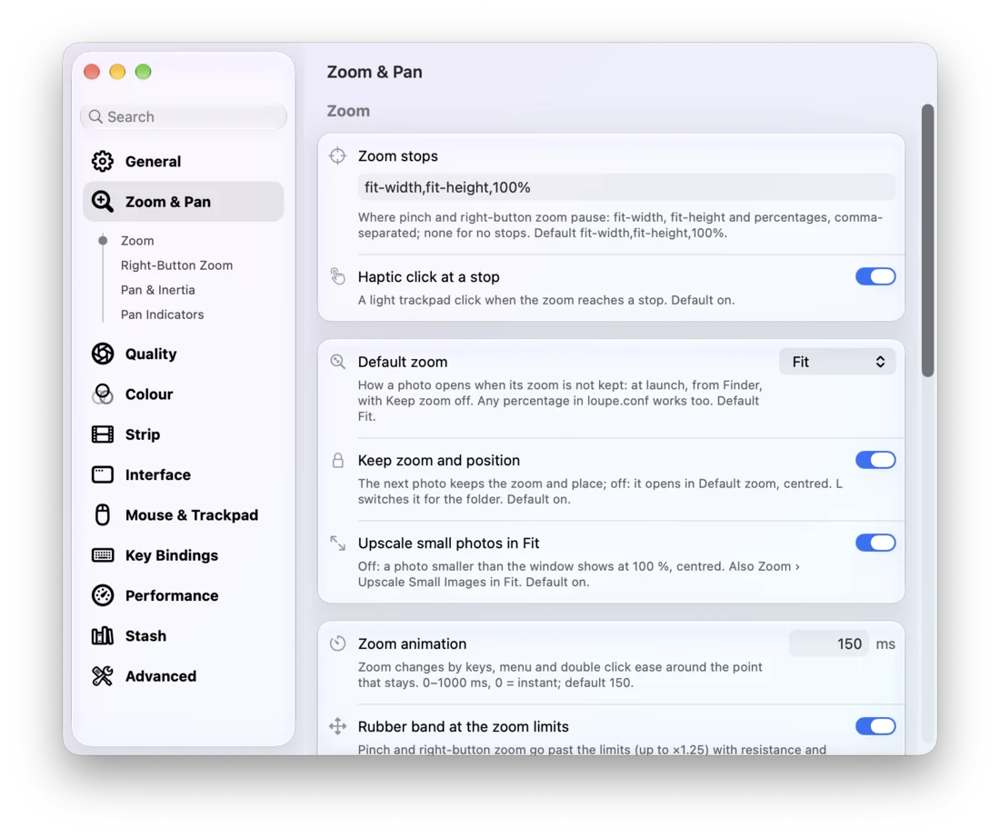</p>

### Icons

<p align="center"></p>

Liquid Glass icons made in Icon Composer. The glass owl follows macOS's light, dark, clear and tinted icon styles; the alternates swap in from **Settings → General → Dock icon**, with a picture of each in the menu. Or bring your own: drop a PNG, an `.icns` or a whole Icon Composer `.icon` package into `~/.config/loupe/icons`, and Loupe compiles it and puts it in the Dock — no rebuild.

<p align="center"></p>

## Stash

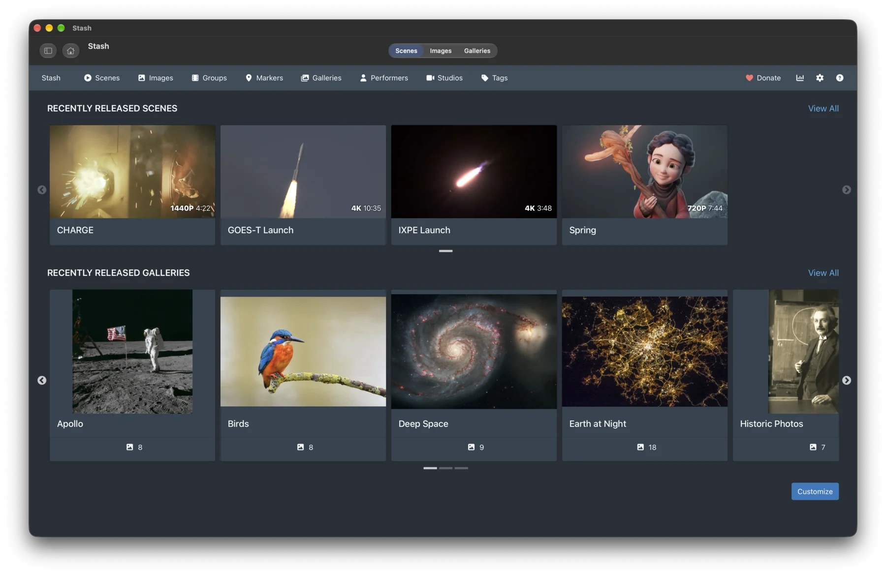

Loupe has a built-in window onto **[Stash](https://github.com/stashapp/stash)**, the self-hosted media organizer: your Stash library opens in a Loupe tab (`⇧⌘L`), and a click on a gallery opens it in Loupe's viewer — straight from your NAS, mounting the share if it isn't mounted yet, with Stash's own order and paging for previous/next.

- Path rules map Stash's paths (including Windows drive letters and `\\server\share`) to your Mac's mounts.
- Zip galleries open like folders, without unpacking.
- Works with or without an API key; **Settings → Stash → Check** verifies the connection.

Stash support is under active development in both Loupe and its sibling video player [FrameScrub](https://github.com/ampire5/FrameScrub).

<p align="center">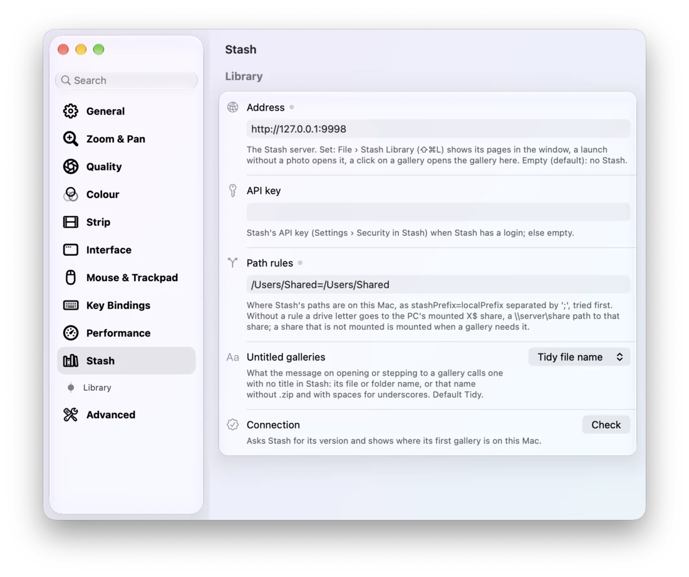</p>

## Under the hood

Native Swift and AppKit: no Electron and no web views, except the Stash tab, which is a WebKit view of your Stash server.

| | |
|---|---|
| **Rendering** | Metal: a tiled image pyramid with its own shaders (Lanczos, EWA, Mitchell, Catmull-Rom, pixel art) in linear light, MetalFX spatial upscaling, display colour management through Core Graphics. |
| **Decoding** | libjpeg-turbo for JPEG; a [fork of libjxl 0.12](https://github.com/ampire5/libjxl/tree/loupe) with two added functions (`JxlDecoderGetDCImage`, `JxlDecoderGetDCByteCount`) for the 1:8 preview; ImageIO for HEIC, AVIF, WebP, PNG, TIFF, GIF and BMP. The decoder is chosen by the file's magic bytes. |
| **Caching** | An actor-based cache that plans which levels of which photos to keep, decode slots reserved for the current photo, prefetch in the direction you're going, a budget of a fifth of the Mac's memory, 1–4 GB, by default (`cache-memory`) and memory-pressure handling. |
| **Colour** | Auto colour and vibrance from Core Image's analysis, baked into a 33³ colour cube that is applied on the GPU, so every frame costs the same. |
| **Storage** | SQLite (the C API, no ORM) for the thumbnail catalog, sessions and per-folder settings. Zip archives are read in place through Compression and zlib. |
| **Input** | `input.conf` bindings for keys, mouse buttons, trackpad gestures and chords; the MX Master 4 over IOKit HID with [LogiHIDPP](https://github.com/ampire5/LogiHIDPP), a HID++ 2.0 library written for this. |
| **Structure** | A SwiftPM package with no Xcode project: `LoupeCore` (files, decoding, cache, config, with no UI), `LoupeRender` (Metal), `LoupeSettings` and the app, on top of the shared packages HomeScreenKit, InfoPanelKit, SettingsKit and StashKit. About 38 000 lines of Swift; scripts assemble the `.app` and bundle the dylibs. |
| **Tests** | 1 789 tests in Swift Testing, including pixel-exact render tests against Core Graphics and a CPU reference; `LoupeBench` for decoding, rendering and browsing numbers; CI on GitHub Actions. |

## Install

> **Frozen (2026-10-23).** Intel Macs on macOS 26 are built from `main` now: one branch, an x86_64 build with Xcode 26
> next to the Apple Silicon one. This branch takes no more backports and no `-lts` releases; it stays for reference.
> Fixes go to `main`.
>
> **This is the `lts/macos26` branch: Loupe for Intel Macs on macOS 26**, the last macOS for them, supported until
> Apple ends macOS 26 security updates (expected autumn 2028). Fixes and selected features come over from `main`
> ([LTS_POLICY.md](https://github.com/ampire5/FrameScrub/blob/lts/macos26/LTS_POLICY.md)). On Apple Silicon, use `main`.

Loupe LTS needs macOS 26 on an Intel Mac. Downloads: the `-lts` releases, `macOS-x86_64`.

```sh
brew install --cask ampire5/tap/loupe
```

Or download the zip from [Releases](https://github.com/ampire5/Loupe/releases). Builds are not signed with an Apple Developer ID yet; the cask clears the quarantine flag for you.

**macOS won't open the downloaded app?** That is Gatekeeper refusing an unsigned build. Try to open Loupe once, then click **Open Anyway** in **System Settings → Privacy & Security**. Or clear the flag yourself:

```sh
xattr -dr com.apple.quarantine /Applications/Loupe.app
```

### Edge builds

The latest build that passed CI, not a release: unsigned, for testing. On Apple Silicon these are `main`'s builds, on Intel `lts/macos26`'s. The `loupe@edge` cask replaces `loupe` and back; your settings and data stay.

```sh
brew uninstall --cask loupe                       # the release, if installed: the two casks conflict
brew install --cask ampire5/tap/loupe@edge
brew update && brew upgrade --cask loupe@edge     # every new build
brew list --cask --versions loupe@edge            # the build you have
```

The version says which commit it is: `0.1.0-lts-8-gf2f5f20` is 8 commits after 0.1.0-lts, at commit `f2f5f20`. Back to the
release: `brew uninstall --cask loupe@edge && brew install --cask ampire5/tap/loupe`.

**If something goes wrong:**

- **`brew upgrade` finds nothing new.** Homebrew updates the tap only now and then: `brew update` first.
- **`404 Not Found` while downloading.** Only the newest edge zip is kept, so your copy of the tap points at one that is
  gone (or a build is being published right now, which takes a minute): `brew update`, then install or upgrade again.
- **`SHA256 mismatch`.** The same build was published again with a new zip. `brew update`, delete the stale download,
  try again:

  ```sh
  rm -f "$(brew --cache --cask loupe@edge)"
  brew upgrade --cask loupe@edge
  ```

- **`Cask 'loupe' conflicts with 'loupe@edge'`.** Only one of the two can be installed: uninstall the other first.
- **A half-installed or broken app.** `brew reinstall --cask loupe@edge`. If Homebrew insists it is installed while the
  app is gone: `brew uninstall --force --cask loupe@edge`, then install again.
- **The build itself is broken** (crashes, something stopped working). Go back to the release and wait for the next
  build; older edge builds are not kept. Please [report it](https://github.com/ampire5/Loupe/issues/new?template=bug_report.yml)
  with the version from `brew list --cask --versions loupe@edge`.
- **It misbehaves even on the release.** Your settings may be the cause. Quit Loupe and move them aside, and it starts
  with the defaults: `mv ~/.config/loupe ~/.config/loupe.bak`. To remove all its data, see Uninstall below.

### Build from source

You need macOS 26 and the Command Line Tools (`xcode-select --install`); Xcode is optional (its `actool` builds the Liquid Glass app icon). On Apple Silicon the scripts cross-build x86_64 (the LTS app's architecture) and run the tests under Rosetta.

```sh
brew install cmake ninja nasm pkgconf
scripts/make-app.sh --install      # → ~/Applications/Loupe.app
```

Loupe links its decoders statically: libjpeg-turbo, brotli, highway, Loupe's own libjxl (v0.12.0 + the DC preview functions, branch `loupe` of [ampire5/libjxl](https://github.com/ampire5/libjxl)) and libheif (LoupeBench only), x86_64. The first build downloads them prebuilt into `.deps/x86_64` (`scripts/deps.sh`), or builds them from source (`scripts/build-deps.sh`, with the tools above) when the recipe has no prebuilt archive yet. The app links them in, and `make-app.sh` checks that nothing links outside the system, so it runs without Homebrew. Homebrew's own `jpeg-xl` lacks the preview functions, so a plain `swift build` fails on purpose — the scripts point it at the build.

### Uninstall

```sh
brew uninstall --cask loupe          # the app
brew uninstall --zap --cask loupe    # the app and all its data
```

Loupe keeps its data in three places, which `--zap` removes:

- `~/.config/loupe` — your settings, bindings and Dock icons.
- `~/Library/Application Support/Loupe` — Recent, sessions and per-folder settings.
- `~/Library/Caches/Loupe` — the thumbnail cache.

## Configure

Everything is in the Settings window (`⌘,`) — and in two plain-text files, so you can keep them in your dotfiles:

- `~/.config/loupe/loupe.conf` — about 130 `key=value` settings, mpv-style.
- `~/.config/loupe/input.conf` — key, mouse, trackpad and MX Master bindings: `<input> <action> [args]`. `Loupe --print-input-conf` prints the full template.

Both reload when you switch back to Loupe; a mistake shows up in the window instead of being ignored. Your own Dock icons go in `~/.config/loupe/icons`.

The Settings window searches every setting, and its **Key Bindings** page is an editor for `input.conf`: press a key or choose a mouse button, pick the action, or go back to the built-in binding. It follows the system's light or dark look; Home and the folder browser stay dark, like a darkroom.

<p align="center">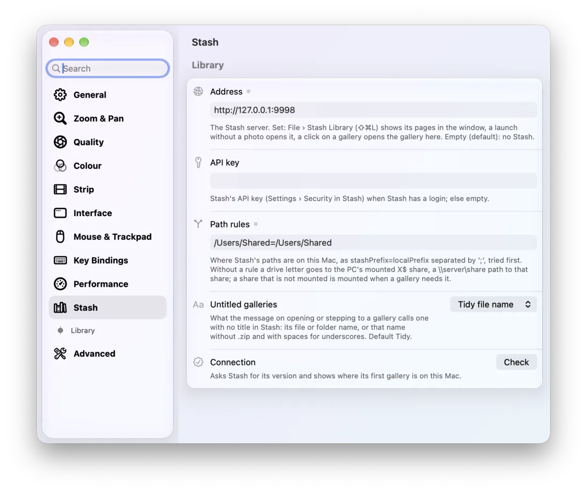 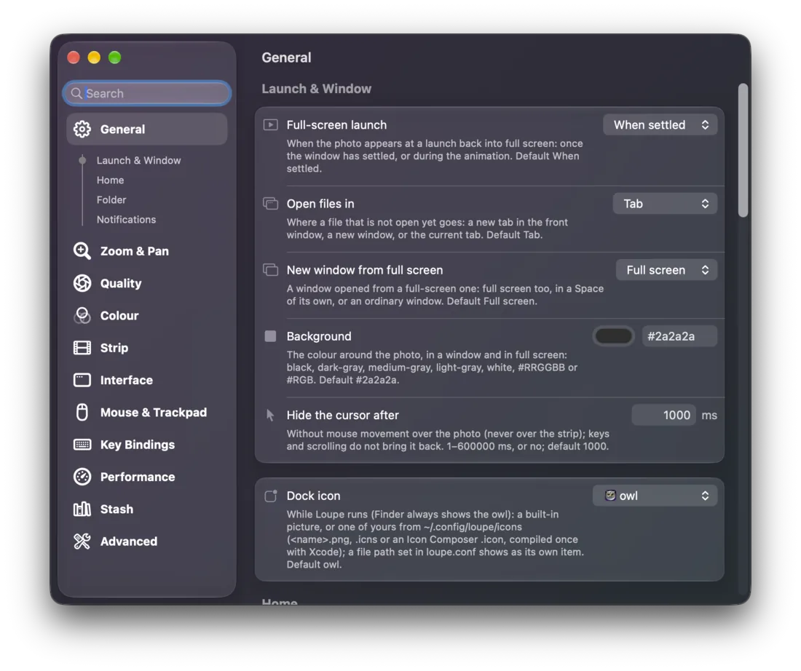</p>

## Privacy

No telemetry, no analytics, no update checks. Loupe reads your files and your shares, and talks to nothing else unless you give it a Stash address (`stash-url`); then it talks to that server only.

## Tests

```sh
scripts/test.sh           # core, ~5 s
scripts/test.sh render    # + pixel-exact render tests, ~80 s
scripts/test.sh full      # everything
```

`LoupeBench` measures decoding, thumbnails, rendering, pyramids, auto colour and the browser; `scripts/latency-matrix.sh` measures input-to-photon latency.

## Feedback, bugs and contributing

**I want to hear what you need.** If Loupe is close to what you want but not quite there, open a [feature request](https://github.com/ampire5/Loupe/issues/new?template=feature_request.yml): what you're trying to do, how you do it today, and what your collection looks like. That is what decides the [roadmap](ROADMAP.md). Questions, half-formed ideas and stories of how you use it are welcome in [Discussions](https://github.com/ampire5/Loupe/discussions).

Found a bug or a photo Loupe gets wrong? Open a [bug report](https://github.com/ampire5/Loupe/issues/new?template=bug_report.yml) with:

- your macOS version and Mac model;
- the stats bar line (`i`) or the info panel's Diagnostics (`⌘I`), which name the format, the decoder and its timings;
- a sample file, if you can share one.

Contributions are welcome. A full contributing guide is on the roadmap; until then, [Build from source](#build-from-source) and [Tests](#tests) cover the basics.

## Roadmap

Next up: side-by-side comparison of two photos, Favorites and Viewed, animated images, HDR photos — and a plugin architecture for media servers. See **[ROADMAP.md](ROADMAP.md)**.

## Image credits

The screenshots show public-domain and openly licensed works: space images by NASA, ESA, CSA and STScI (Webb and Hubble, CC BY 4.0) and NASA (public domain); paintings and sculpture from The Metropolitan Museum of Art Open Access (CC0) and public-domain works on Wikimedia Commons (Van Gogh, Hokusai, Leonardo, Vermeer, Bruegel, Klimt, Munch, Kandinsky, Mondrian and others); historic photographs in the public domain (Library of Congress, NARA); birds and animals under CC0.

## License

[GPL-3.0](LICENSE). Loupe uses [libjxl](https://github.com/libjxl/libjxl) (BSD-3-Clause) and [libjpeg-turbo](https://libjpeg-turbo.org) (BSD-style), and the MIT-licensed packages [HomeScreenKit](https://github.com/ampire5/HomeScreenKit), [InfoPanelKit](https://github.com/ampire5/InfoPanelKit), [SettingsKit](https://github.com/ampire5/SettingsKit) and [StashKit](https://github.com/ampire5/StashKit), and [LogiHIDPP](https://github.com/ampire5/LogiHIDPP) (GPL-3.0).
